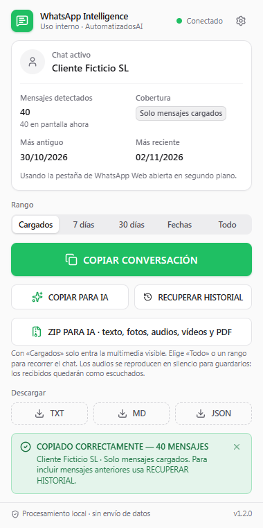
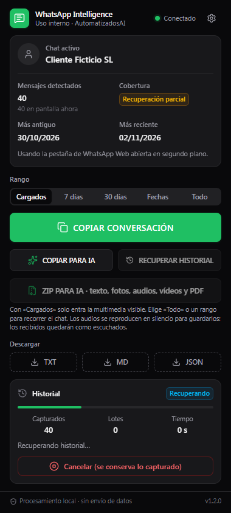

# WhatsApp Intelligence

Extensión de Google Chrome (Manifest V3) de uso interno de **AutomatizadosAI**. Con una conversación abierta en `https://web.whatsapp.com`, un clic en **COPIAR CONVERSACIÓN** copia al portapapeles los mensajes recuperados (remitente, fecha, hora y texto, en orden cronológico), listos para pegarlos en Claude, ChatGPT o cualquier editor.

Todo se procesa en el propio navegador: sin servidores, sin telemetría, sin enviar conversaciones a nadie.

| Claro | Oscuro (recuperando historial) |
| --- | --- |
|  |  |

> Las capturas se generan con datos ficticios en las pruebas automáticas (`npm run test:e2e`).

## Estado

- **V1 funcional y probada con un simulador del DOM de WhatsApp Web** (pruebas unitarias + Playwright con la extensión real cargada en Chromium).
- **Pendiente: validación en WhatsApp Web real.** No se ha ejecutado contra una cuenta real. Sigue [docs/VALIDACION-MANUAL.md](docs/VALIDACION-MANUAL.md).
- Resultados medidos y limitaciones: [docs/INFORME.md](docs/INFORME.md). Privacidad: [docs/PRIVACIDAD.md](docs/PRIVACIDAD.md).

## Instalación (Cargar descomprimida)

1. Abre `chrome://extensions`.
2. Activa **Modo de desarrollador** (arriba a la derecha).
3. Pulsa **Cargar descomprimida** y elige la carpeta **`dist`** de este repositorio.
4. Si WhatsApp Web ya estaba abierto, **recarga su pestaña** (F5) para que la extensión se active en ella. El popup ofrece un botón para hacerlo.
5. Opcional: fija el icono en la barra (icono de puzle → chincheta).

Requisitos: Chrome 114 o superior.

Para actualizar tras un cambio: `npm run build` y pulsa el botón de recarga de la extensión en `chrome://extensions`.

## Uso

1. Abre WhatsApp Web y selecciona una conversación.
2. Pulsa el icono de **WhatsApp Intelligence**.
3. Elige el **rango**: *Cargados* (todo lo capturado), *7 días*, *30 días*, *Fechas* (personalizado) o *Todo* (lo recuperable).
4. Pulsa **COPIAR CONVERSACIÓN**. El éxito solo se muestra cuando el portapapeles ha confirmado la escritura: `COPIADO CORRECTAMENTE — N MENSAJES`.
5. Pega donde quieras (Ctrl+V).

Otras acciones:

- **COPIAR PARA IA**: copia la conversación precedida de las instrucciones para generar el expediente comercial (18 apartados; separa hechos, propuestas, hipótesis y pendientes).
- **ZIP PARA IA**: recorre el chat en el rango elegido y descarga un ZIP con la conversación (TXT, JSON e instrucciones para la IA) y la carpeta media/ con fotos, audios, vídeos y documentos (PDF, Word, Excel…, con su nombre original). Con «Cargados» solo entra la multimedia visible; usa «Todo» o un rango. Las notas de voz se reproducen en silencio para guardarlas, así que las recibidas quedan como escuchadas.
- **RECUPERAR HISTORIAL**: desplaza el chat hacia arriba por lotes para cargar mensajes antiguos. Muestra el progreso real (capturados, lotes, tiempo, estado) y se puede **cancelar** sin perder lo capturado. Puedes cerrar el popup: la recuperación sigue en la pestaña. Con rango de 7/30 días o fechas, para al alcanzar la fecha inicial.
- **DESCARGAR TXT / MD / JSON**: genera el archivo localmente con `chrome.downloads`.
- **Ajustes** (engranaje): etiquetas de remitente (roles CLIENTE/EMPRESA o nombres visibles), mensajes del sistema, límites de la recuperación, caducidad de las copias temporales, borrado de datos y **diagnóstico de selectores sin contenido**.

Si el portapapeles falla, el popup muestra el texto completo seleccionable, un botón de descarga TXT y, si el texto es grande, la copia por **partes numeradas** sin recortes.

## Formato de salida

```
CONVERSACIÓN: Cliente Ficticio SL
EXPORTADO: 02/11/2026 12:00
MENSAJES RECUPERADOS: 4
RANGO: 25/10/2026 10:34 - 25/10/2026 10:39
COBERTURA: Solo mensajes cargados
TIPO DE CHAT: Individual
PARTICIPANTES: CLIENTE = Cliente Ficticio SL · EMPRESA = mensajes enviados desde esta cuenta de WhatsApp
ADVERTENCIAS:
- Solo se incluyen los mensajes cargados en WhatsApp Web. Puede haber mensajes anteriores no recuperados: usa RECUPERAR HISTORIAL.

[25/10/2026 10:34] CLIENTE:
Hola, necesitamos automatizar la gestión de facturas.

[25/10/2026 10:36] EMPRESA:
Perfecto. ¿Cuántas gestionáis mensualmente?

[25/10/2026 10:38] CLIENTE:
Unas 300.

[25/10/2026 10:39] CLIENTE:
[AUDIO: transcripción no disponible]
```

Nunca se inventan valores: `FECHA NO DISPONIBLE`, `HORA NO DISPONIBLE`, `REMITENTE DESCONOCIDO`, `(fecha deducida)` cuando el orden día/mes o el año no se pudo leer. Marcadores multimedia: `[AUDIO: transcripción no disponible]`, `[IMAGEN]`, `[VÍDEO]`, `[GIF]`, `[STICKER]`, `[DOCUMENTO: nombre.pdf]`, `[UBICACIÓN]`, `[CONTACTO]`, `[ENCUESTA]`, `[MENSAJE ELIMINADO]`. Las respuestas citadas aparecen como `> Respondiendo a …`, los editados con `(editado)` y los reenviados con `[Reenviado]`.

**Cobertura**: *Solo mensajes cargados* (no se ha recuperado historial), *Recuperación parcial* (se intentó pero no hay evidencia de haber llegado al inicio) o *Inicio aparente alcanzado* (se vio el aviso de cifrado que WhatsApp muestra al principio del chat).

El JSON sigue el esquema `automatizadosai/whatsapp-intelligence/conversation` versión `1.0.0` (metadatos, cobertura, participantes, mensajes con dirección, tipo, fecha, hora, procedencia del timestamp y advertencias). No incluye el número de teléfono ni identificadores internos del chat.

## Arquitectura

```
src/
  adapters/whatsapp/  selectores centralizados + lectura del DOM (único punto que conoce WhatsApp Web)
  extraction/         texto visible sin innerHTML (emojis, saltos, enlaces)
  normalization/      fechas/horas (funciones puras), RawMessage -> Message
  deduplication/      claves (id del DOM o huella) y fusión de lotes solapados
  content/            content script: almacén por chat, motor de historial, driver DOM
  background/         service worker: copias temporales en chrome.storage.session
  storage/            checkpoints con TTL y ajustes
  export/             TXT, Markdown, JSON, Copiar para IA, bloques, rangos, nombres de archivo
  audio/              interfaz opcional de transcripción (V1: sin transcripción)
  popup/              React + Tailwind: interfaz, portapapeles, descargas
  shared/             tipos y protocolo de mensajes
  tests/              fixtures ficticios, Vitest (unit) y Playwright (e2e)
```

Flujo de COPIAR: popup → `WAI_EXTRACT` al content script → lectura del DOM → normalización → fusión con lo ya capturado del mismo chat → copia temporal → popup aplica rango y formato → `navigator.clipboard.writeText` (o `execCommand('copy')` como alternativa) → éxito solo si se confirma.

Decisiones clave:

- **Identidad del chat** por el JID que WhatsApp expone en el `data-id` de cada mensaje (o el título si no existe). Cada lectura se comprueba contra el chat activo y se descartan elementos de otro chat.
- **Deduplicación**: id estable del DOM si existe; si no, huella (chat, dirección, remitente, fecha, hora, tipo, texto, cita) + número de aparición respecto al mensaje con id más cercano. Dos «Ok» seguidos son dos mensajes.
- **Orden**: el de WhatsApp (cronológico); los timestamps exactos se validan y cualquier salto atrás se avisa.
- **Selectores**: ids, `data-*`, roles ARIA y clases semánticas históricas (`message-in/out`, `copyable-text`). Nunca clases ofuscadas. Todo en `src/adapters/whatsapp/selectors.ts`.
- **Copias temporales** en `chrome.storage.session`: en memoria, no se escriben a disco, caducan (12 h por defecto) y se borran al cerrar Chrome.

## Desarrollo

```bash
npm install
npm run build        # genera dist/
npm run typecheck
npm run lint
npm test             # Vitest
npm run test:e2e     # Playwright (requiere dist/ y Chromium de Playwright: npx playwright install chromium)
```

Las pruebas E2E cargan `dist/` en Chromium, sirven `https://web.whatsapp.com/` localmente mediante intercepción de red con un simulador del DOM (nunca contactan con WhatsApp) y usan el popup real. **Escriben en el portapapeles real del sistema.**

## Permisos

| Permiso | Para qué |
| --- | --- |
| `host_permissions: https://web.whatsapp.com/*` | Content script y localizar la pestaña de WhatsApp. Ningún otro dominio. |
| `clipboardWrite` | Copiar desde el popup (y alternativa `execCommand`). |
| `downloads` | Descargar TXT/MD/JSON. |
| `storage` | Copias temporales en memoria de sesión y ajustes. |

CSP de las páginas de la extensión: `script-src 'self'; object-src 'none'; connect-src 'none'`. La interfaz no puede hacer peticiones de red.
